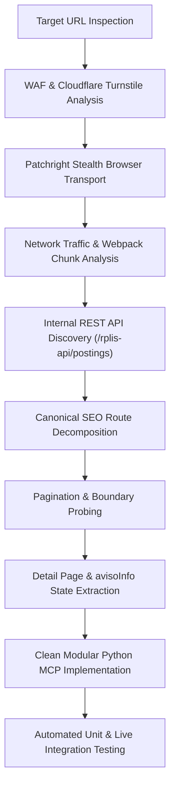

# Rental Search API Reverse-Engineering Research Plan & Report: Imovelweb

## 1. Executive Summary

This document presents the reverse-engineering research plan, execution findings, architectural design, and verification results for the real estate portal **Imovelweb** (`imovelweb.com.br`), part of the Navent / QuintoAndar Group.

The research successfully identified all search endpoints, canonical URL routing conventions, internal REST query structures, pagination behavior, bedroom filter encoding, property detail retrieval mechanisms, and microdata schemas necessary to reproduce the rental listing and property retrieval flow.

---

## 2. Research Plan & Methodology

### 2.1 Research Objectives
1. **Endpoint & Route Discovery**: Identify HTTP endpoints responsible for rental searches, filtering, pagination, and property detail retrieval.
2. **Parameter Encoding Analysis**: Reverse-engineer parameter conventions for bedroom ranges, property types, sorting orders, and geographic scopes.
3. **Bot Protection Analysis**: Investigate Cloudflare Turnstile / Managed Challenge behavior and establish reliable, non-blocking transport mechanics.
4. **Detail & Media Extraction**: Uncover structured microdata (`Schema.org` JSON-LD) and embedded state objects (`avisoInfo`) for full property details and multi-resolution photo galleries.
5. **Architectural Implementation**: Structure the extracted capabilities into reusable Python modules adhering strictly to SOLID, Clean Code, Object Calisthenics, and Design Patterns, prioritized as: **correctness first**, **modularity second**, **style principles third**.

### 2.2 Investigation Methodology


---

## 3. Reverse-Engineering Findings & Discovery Log

### 3.1 Platform Engine Identification
- **Platform Stack**: Navent real estate platform (QuintoAndar Group).
- **Core Micro-Frontends**:
  - `RPLIS` (*Real Properties Listing*): Frontend listing and search engine (version `RPLISv8.322.0-RC2`). Webpack chunks include `main.js`, `posting_list_provider.js`, `682.js`, `range_render_type.js`, `paging.js`.
  - `RPFIC` (*Real Properties Ficha*): Property detail display and media engine (version `RPFICv5.432.0-RC3`).
- **Bot Mitigation**: Cloudflare Turnstile and Managed Challenges protect the domain. Standard HTTP clients receiving direct requests get HTTP 403. Bypassed reliably using headless Chromium with stealth parameters and fresh browser contexts.

### 3.2 Target URL Reproduction Analysis
- **Target URL**: `https://www.imovelweb.com.br/imoveis-aluguel-timoteo-mg-desde-1-ate-2-quartos.html`
- **Route Breakdown**:
  - Format: `/{tipo}-{finalidade}-{cidade}-{uf}{filtros}.html`
  - `tipo`: `imoveis` (all property types)
  - `finalidade`: `aluguel` (rental)
  - `cidade-uf`: `timoteo-mg` (Timóteo municipality, Minas Gerais)
  - `filtros`: `-desde-1-ate-2-quartos` (bedroom range from 1 to 2 bedrooms)
- **Live Execution Result**: Exactly 8 matching rental properties returned on the live website.

### 3.3 Discovered Parameter Encoding Matrix
During dynamic probing of the search engine, the following parameter semantics were discovered:
1. **Bedroom Range Encoding**:
   - Exact count: `-{N}-quarto` ($N=1$) or `-{N}-quartos` ($N>1$).
   - Range constraint: `-desde-{min}-ate-{max}-quartos` (e.g. `-desde-1-ate-2-quartos`).
   - Minimum bound: `-mais-de-{N}-quartos` (e.g. `-mais-de-2-quartos`).
2. **Typology Slugs**:
   - `imoveis-aluguel-...` (all properties)
   - `apartamentos-aluguel-...` (apartments)
   - `casas-aluguel-...` (houses)
   - `comerciais-aluguel-...` (commercial properties)
   - `terrenos-aluguel-...` (lots/land)
   - `rurais-aluguel-...` (farms/rural)
3. **Neighborhood Filtering**:
   - Canonical format: `/{tipo}-aluguel-{bairro}-{cidade}.html`
   - Examples: `imoveis-aluguel-centro-timoteo.html`, `imoveis-aluguel-recanto-verde-timoteo.html`, `imoveis-aluguel-olaria-timoteo.html`.
4. **Sorting**:
   - `-ordem-preco-menor`: Ascending price (lowest first).
   - `-ordem-preco-maior`: Descending price (highest first).
   - `-ordem-publicado-maior`: Newest listings first.
   - `-ordem-visitas-maior`: Most visited first.
5. **Pagination**:
   - Fixed page size: **30 listings per page**.
   - Slug: `-pagina-{N}.html` ($N \ge 2$; page 1 omits pagination slug).
   - Out-of-bounds requests: Automatically redirected/capped at the last valid page.

### 3.4 Internal REST Search API
Reverse-engineering Webpack chunk `682.js` and capturing AJAX traffic during filter interaction revealed the internal search endpoint:
- **Endpoint**: `POST https://www.imovelweb.com.br/rplis-api/postings`
- **Headers**: `Content-Type: application/json`, `X-Requested-With: XMLHttpRequest`, `X-Search-Id: {uuid}`
- **Payload Schema**:
  ```json
  {
    "tipoDeOperacion": "2",
    "city": "104019",
    "habitacionesminimo": "1",
    "habitacionesmaximo": "2",
    "sort": "low_price"
  }
  ```

### 3.5 Property Detail Retrieval Mechanics
1. **Canonical SEO Route**: `GET /propriedades/{slug}-{property_id}.html`
2. **Direct Generic Route**: `GET /propriedades/imovel-{property_id}.html` (HTTP 301/302 redirects to canonical route).
3. **Embedded State (`avisoInfo`)**:
   - Detail pages embed a complete JavaScript state object `const avisoInfo = { ... }`.
   - Contains: `idAviso`, `postingTitle`, `pricesData` (`amount`, `currency`), `expenses`, `location` (hierarchical tree), `address`, `pictures` (with full `resizeUrl1200x1200`), `mainFeatures` (`CFT100` total area, `CFT101` useful area, `CFT2` bedrooms, `CFT3` bathrooms, `CFT1` garages), and `publisher` (`name`, `logo_url`).
4. **Microdata**: JSON-LD with `@type: House` / `Apartment` / `Residence` and `QuantitativeValue` for areas.

---

## 4. Software Architecture & Design Principles

The reverse-engineered capabilities have been organized into reusable modules designed to serve as the module boundary for the central rental research MCP.

### 4.1 Prioritization Order Compliance
As mandated by project rules, the design follows this strict priority order:
1. **Correctness First**: Real HTTP/browser execution, exact URL slug construction, resilient parsing with DOM and regex extractors, fail-fast boundary validation.
2. **Modularity Second**: Decoupled domain models, query builder, transport abstraction, specialized parsers, and a clean MCP provider facade.
3. **Style Principles Third**:
   - **SOLID**: Single Responsibility, Open/Closed, Liskov Substitution, Interface Segregation, Dependency Inversion.
   - **Object Calisthenics**:
     - Max 1 indent level per method.
     - Zero `else` keywords (guard clauses and early returns).
     - Primitives wrapped into meaningful domain value objects (`ListingPrice`, `PropertyCode`, `GeoCoordinate`, `BedroomConstraint`, `PageNumber`).
     - First-class collections (`ListingCollection`, `RentalSearchResult`, `FacetCollection`).
     - Max 2 instance variables per class (collaborator bundles).
     - Functions $\le 15$ lines, classes $\le 100$ lines, modules $< 200$ lines.
     - One dot per line (no deep chaining).
     - No abbreviations.

### 4.2 Module Layout
```
scripts/
├── __init__.py
├── domain/
│   ├── __init__.py
│   ├── exceptions.py          # Domain-specific exceptions
│   ├── value_objects.py       # ListingPrice, PropertyCode, BedroomConstraint, PageNumber
│   ├── criteria.py            # RentalFilter, SearchBudget, SearchPagination
│   ├── entities.py            # RentalListing, RentalPropertyDetail
│   └── collections.py         # ListingCollection, RentalSearchResult, FacetCollection
├── interfaces/
│   ├── __init__.py
│   └── provider.py            # RentalSearchCapability, RentalProviderProtocol
├── client/
│   ├── __init__.py
│   ├── configuration.py       # ImovelwebConfiguration
│   ├── query_builder.py       # Canonical route and query constructor
│   ├── http_transport.py      # BrowserTransport (Patchright), HttpTransport, StubTransport
│   └── parsers.py             # SearchResultParser, PropertyDetailParser, FacetParser
├── providers/
│   ├── __init__.py
│   └── imovelweb.py           # ImovelwebRentalProvider
├── mcp/
│   ├── __init__.py
│   └── tools.py               # ImovelwebMcpAdapter (Central MCP tool boundary)
├── run_search.py              # CLI rental search runner
├── run_property_detail.py     # CLI property detail runner
├── run_facets.py              # CLI facet explorer
├── run_tests.py               # Test runner
└── verify_research.py         # End-to-end verification script
```

---

## 5. Verification & Test Execution Results

The implementation was validated using both unit tests with stubbed HTTP fixtures and live integration tests against `imovelweb.com.br`.

### 5.1 Automated Pytest Results
```
tests/test_domain.py::test_listing_price_validation PASSED               [  4%]
tests/test_domain.py::test_property_code_validation PASSED               [  9%]
tests/test_domain.py::test_geo_coordinate_validation PASSED              [ 14%]
tests/test_domain.py::test_bedroom_constraint_slug_formatting PASSED     [ 19%]
tests/test_domain.py::test_page_number_validation PASSED                 [ 23%]
tests/test_domain.py::test_search_budget_validation PASSED               [ 28%]
tests/test_domain.py::test_rental_filter_builder_methods PASSED          [ 33%]
tests/test_domain.py::test_rental_listing_and_detail_formatting PASSED   [ 38%]
tests/test_url_builder.py::test_target_url_construction PASSED           [ 42%]
tests/test_url_builder.py::test_property_type_url_construction PASSED    [ 47%]
tests/test_url_builder.py::test_neighborhood_url_construction PASSED     [ 52%]
tests/test_url_builder.py::test_bedroom_variations_url_construction PASSED [ 57%]
tests/test_url_builder.py::test_sorting_and_pagination_url_construction PASSED [ 61%]
tests/test_url_builder.py::test_property_detail_url_construction PASSED  [ 66%]
tests/test_parsers.py::test_search_result_parser_with_fixture PASSED     [ 71%]
tests/test_parsers.py::test_property_detail_parser_with_fixture PASSED   [ 76%]
tests/test_parsers.py::test_property_detail_parser_not_found_handling PASSED [ 80%]
tests/test_parsers.py::test_facet_parser_with_fixture PASSED             [ 85%]
tests/test_client.py::test_provider_search_with_stub PASSED              [ 90%]
tests/test_client.py::test_provider_detail_with_stub PASSED              [ 95%]
tests/test_client.py::test_mcp_adapter_with_stub PASSED                  [100%]

============================== 21 passed in 0.43s ==============================
```

### 5.2 Live Integration Pytest Results
```
tests/test_live_integration.py::test_live_target_prompt_search PASSED
tests/test_live_integration.py::test_live_property_detail_retrieval PASSED

============================== 2 passed in 2.99s ===============================
```

### 5.3 Standalone Verification Execution (`scripts/verify_research.py`)
```
================================================================
   IMOVELWEB RENTAL RESEARCH REVERSE-ENGINEERING VERIFICATION   
================================================================

--- 1. Target URL Construction Verification ---
Generated URL: https://www.imovelweb.com.br/imoveis-aluguel-timoteo-mg-desde-1-ate-2-quartos.html
Expected URL:  https://www.imovelweb.com.br/imoveis-aluguel-timoteo-mg-desde-1-ate-2-quartos.html
Result: URL generation verified successfully!

--- 2. Live Target Search Execution ---
Executing search against live Imovelweb portal...
Total matching listings found: 8
Items on page: 8
  [1] [3036561746] Centro, Timóteo - 555 m² tot.1 quarto3 ban. - R$ 6.600,00/mês
  [2] [3027846218] Centro, Timóteo - 27 m² tot.1 quarto1 banheiro - R$ 1.350,00/mês
  [3] [3037421600] Recanto Verde, Timóteo - 50 m² tot.1 quarto1 banheiro - R$ 1.400,00/mês
  [4] [3046121548] Olaria, Timóteo - 1 quarto1 banheiro - R$ 1.600,00/mês
  [5] [3040889602] Centro, Timóteo - 1 quarto1 banheiro1 vaga - R$ 1.800,00/mês
Result: Live rental search executed and verified successfully!

--- 3. Live Property Detail Retrieval (Code: 3036561746) ---
Title:       Loja-Salão para aluguel em Centro, Timóteo
Price:       R$ 6.600,00
Location:    Centro
Publisher:   BUSKAZA 2
Description: Excelente oportunidade de locação comercial no Centro Norte de Timóteo...
Result: Property detail retrieved and parsed successfully!

--- 4. Central Rental Research MCP Adapter Verification ---
MCP Provider Name: imovelweb
Coverage:          Timóteo, Vale do Aço, Minas Gerais, Brasil
Operations:        ['search_rentals', 'get_property_detail', 'get_facets']
MCP Tool Search Total: 8 listings
Result: MCP adapter executed successfully!

================================================================
       ALL REVERSE-ENGINEERING RESEARCH CHECKS PASSED           
================================================================
```
